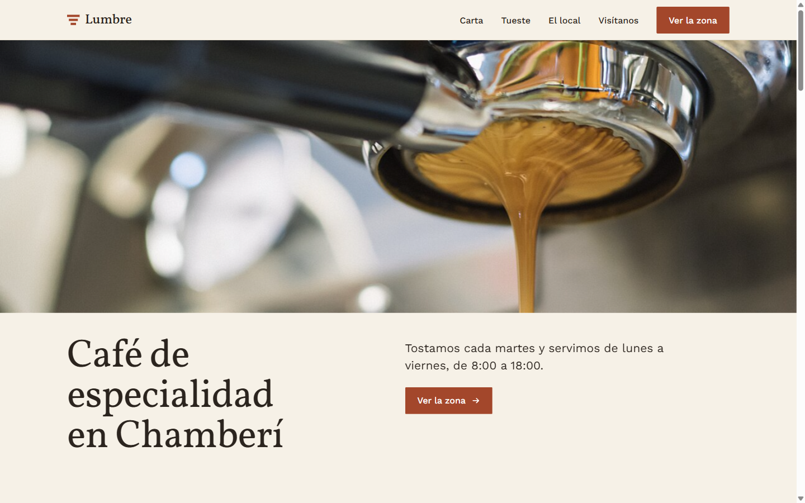

# Lumbre · Café de especialidad en Chamberí

Web de una página para **Lumbre**, una cafetería de especialidad en Chamberí (Madrid). Presenta la carta de la barra, el tueste semanal (cada martes, en tandas de 12 kilos), el local y la información para visitarlo: horario de lunes a viernes de 8:00 a 18:00 y ubicación.

🌐 **Web publicada:** https://robert1340.github.io/lumbre-cafe/



## Secciones

- **Portada**: titular y llamada a la acción.
- **Visítanos**: horario y ubicación.
- **La carta de la barra**: espresso, filtro y otras bebidas.
- **Tueste**: cómo y cuándo tostamos el café.
- **El local**: del grano verde a la taza.
- **Cierre**: el café de la semana.

## Tecnologías

- **HTML5** semántico en un solo archivo (`index.html`).
- **CSS** propio, sin frameworks, con diseño adaptable a móvil, tableta y escritorio.
- **JavaScript** sin librerías para las interacciones.
- **Google Fonts**: Vollkorn (titulares) y Work Sans (texto).
- Imágenes optimizadas en **JPG y WebP** con varios tamaños (`srcset`).
- **GitHub Pages** para alojar la web.

## Estructura

```
.
├── index.html        # La web completa
├── assets/img/       # Fotografías y créditos (credits.json)
└── docs/captura.png  # Captura para este README
```

## Ver en local

No necesita instalación ni compilación. Abre `index.html` en el navegador o, si prefieres un servidor local:

```bash
python -m http.server 8000
```

y entra en http://localhost:8000.

## Créditos de las imágenes

Las fotografías proceden de Wikimedia Commons con licencias Creative Commons (CC0, CC BY y CC BY-SA). La autoría y la licencia de cada una aparecen en la propia web y en `assets/img/credits.json`.
